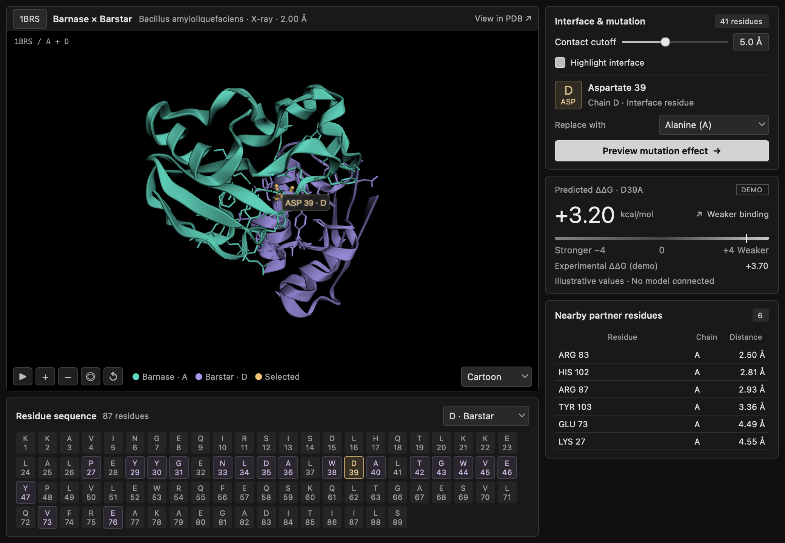

# ProteinBinding

An early desktop GUI for our protein-binding project, built with PySide6, Qt Widgets, and 3Dmol.js. The GUI connects to the team's structure parser and HRas mutation scoring functions through `src/adapters/hras.py`.

The layout puts the 3D structure and residue sequence on the left, and predefined contact sites, mutation selection, scores, and PI3K partner amino acids on the right. The default structure is the tracked `reference/hras_project/4EFL.cif`, showing H-Ras chain A.



## Set up the environment

Install [micromamba](https://mamba.readthedocs.io/en/latest/installation/micromamba-installation.html) first. Run the following commands from the project root, where this README is located.

Use `environment.yml` as the shared environment definition. It includes Python 3.12 and the project's Python dependencies.

Create the environment once:

```bash
micromamba create -n ProteinBinding -f environment.yml -y
```

Activate it before running the project:

```bash
micromamba activate ProteinBinding
```

When adding a package, add it to `environment.yml` and commit that change. Teammates can then update their existing environment with:

```bash
micromamba env update -n ProteinBinding -f environment.yml
```

## Download the local resources

The `resources/` directories are excluded from Git. Download the viewer library after cloning; the command creates the target directory automatically.

Download the pinned 3Dmol.js library:

```bash
curl --fail --location --create-dirs \
  'https://cdn.jsdelivr.net/npm/3dmol@2.5.3/build/3Dmol-min.js' \
  --output src/resources/vendor/3Dmol.min.js
```

The default 4EFL structure is already tracked in the repository. Once the viewer library is downloaded, the GUI runs locally without a server or an internet connection.

## Run

With the `ProteinBinding` environment active, run:

```bash
python src/__main__.py
```

To use another compatible HRas structure and author chain ID:

```bash
python src/__main__.py --structure /path/to/hras.pdb --chain B
```

PDB and mmCIF files, including `.gz`, are supported. 

## Project structure

The main files and their responsibilities:

```text
.
├── environment.yml             # Primary environment and dependency definition
├── pyproject.toml              # Ruff configuration
├── README.md
├── reference/
│   └── hras_project/           # Alan's existing example code and structure data
│       ├── 4EFL.cif
│       └── pdb_parser.py
├── src/
│   ├── __main__.py             # Entry point and wiring of concrete implementations
│   ├── contracts.py            # GUI-facing data types and interfaces
│   ├── presenter.py            # User actions, application state, and workflow
│   ├── view.py                 # Qt window and standard widgets
│   ├── viewer.py               # Molecular viewer and Python–JavaScript bridge
│   ├── tasks.py                # Background task execution
│   ├── style.qss               # Qt colors, typography, and widget styles
│   ├── icons/                  # Small, tracked GUI assets
│   ├── viewer_web/
│   │   ├── index.html          # Local page inside QWebEngineView
│   │   └── viewer.js           # 3Dmol rendering and selection events
│   ├── adapters/
│   │   ├── __init__.py
│   │   └── hras.py             # Parser/contact-table mapping and scoring adapter
│   ├── backend/
│   │   ├── structure_parser.py # PDB/mmCIF parser
│   │   └── aa_array.py         # Fixed contact sites
│   └── resources/
│       └── vendor/
│           └── 3Dmol.min.js    # Downloaded locally; excluded from Git
└── tests/
    ├── functional/            # unittest: single-chain 3D, selection, and scoring flow
    └── unit/                  # unittest: adapter and presenter behavior without Qt
```

## Tests and code checks

Tests use Python's standard-library **`unittest`**. Run commands from the project root with the environment active.

Adapter and presenter tests, without starting Qt or downloading the viewer resources:

```bash
PYTHONPATH=src python -m unittest discover -s tests/unit -v
```

GUI checks require a desktop session and the downloaded 3Dmol.js library:

```bash
PYTHONPATH=src:. python -m unittest discover -s tests/functional -v
```

## Team to-do list

- [ ] Natalie: Data extraction
- [x] Julian: GUI
- [ ] Alan: Further data manipulation

## Message board


